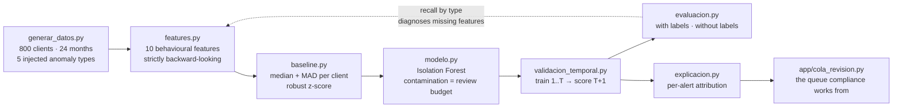
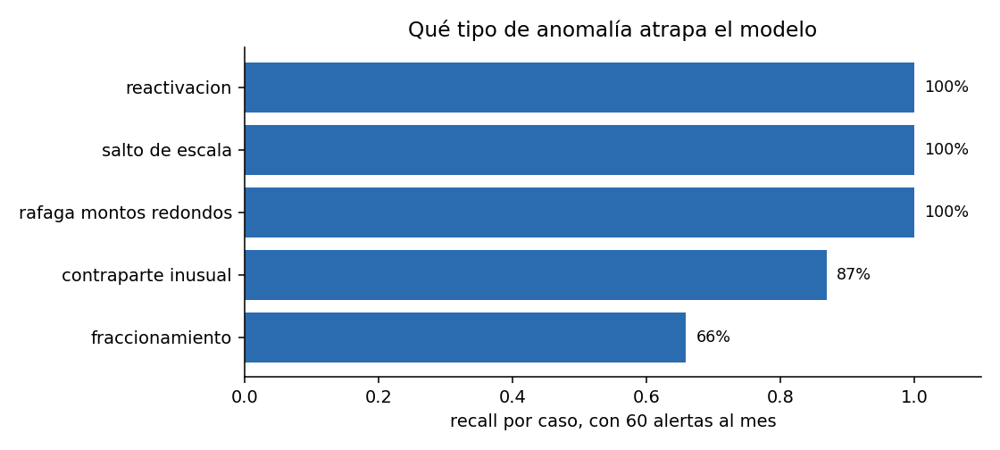
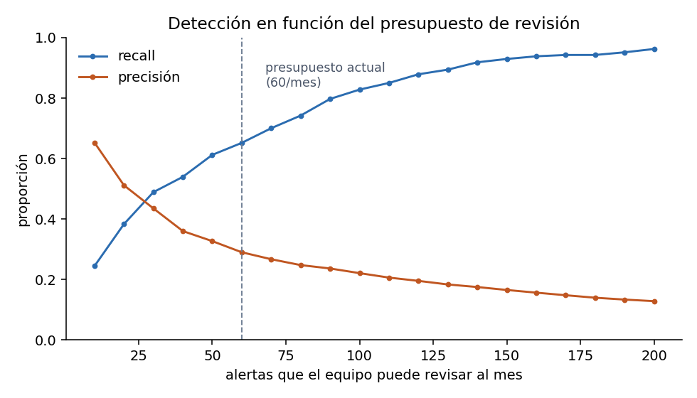

# AML Anomaly Detection — Review Queue

> Unsupervised prioritization of lease payments for anti-money-laundering
> review, when nobody has ever labelled a single case as laundering.
> Learns what is normal **for each client** and ranks what departs from it.

   

> [!IMPORTANT]
> **Reference implementation on synthetic data.** The production system this is
> modeled on is **in design, not deployed**. The data here is *generated*, not
> anonymized — no real record, and no anonymized real record, was used. The
> modeling approach, the validation protocol and the privacy constraint are the
> ones I would deploy; the numbers below describe this synthetic dataset and
> nothing else.

**▶ Live demo:** *(pending deploy — the link goes here)*

---

## The problem

A real estate group has to review lease payments for unusual activity under
Mexico's AML law (LFPIORPI). Thousands of payments a month, a compliance team
of three, and **no labels**: nobody in the company's history ever marked a
transaction as laundering. There is no `y` to train on, and there never will
be one until somebody starts reviewing and recording verdicts.

So a classifier is off the table. The problem gets turned around:

> Instead of learning what fraud looks like, learn **what normal looks like for
> each client**, and raise a hand when something departs from it.

The output is not an accusation. It is **a prioritized review queue** — the
sixty cases most worth a human's morning.

## What I built

A full detection pipeline on synthetic lease data: a generator, behavioural
features, a robust per-client baseline, an Isolation Forest calibrated against
the team's actual capacity, expanding-window temporal validation, evaluation
with *and without* labels, per-alert attribution, and the Streamlit queue a
compliance analyst would work from.

| | |
|---|---|
| **Stack** | Python 3.11+ · pandas · scikit-learn · Streamlit · matplotlib |
| **Data** | 22,358 synthetic payments · 800 clients · 24 months · 474 injected anomalies (2.1%) |
| **Validated on** | 17 months, expanding window, 15,850 scored operations |
| **Result** | 29% precision at a 60-alert budget vs a 2.9% base rate — **10.1× better than chance**, and 1.4× better than the statistical baseline alone |
| **Runs with** | no credentials, no database, no network |

---

## Architecture



That dashed arrow is not decoration — see *The feature that was missing*, below.

---

## Design decisions

### Normality is per client, not per portfolio

One tenant pays $18,000 on the 3rd, every month, without fail. Another pays
$420,000 in two instalments somewhere mid-month. Both are normal. Any global
threshold either drowns the first in false positives or lets the second hide
anything under it.

So every feature is relative to the client's own history:
`monto_vs_mediana_propia`, `desv_vs_ritmo_propio`, `pct_del_total_anual`. The
question is never "is this payment large?" but "**is this large for them?**"

### The model never sees who the client is

The feature matrix contains ten behavioural columns and an integer client id.
No name, no tax ID, no address, no email, no line of business. For the
algorithm, client 4471 is 4471.

Two reasons, and the second is the one that matters technically:

- **Data minimization.** In an AML context, the less identifiable data flows
  into a model, the smaller the exposure — and the easier the system is to
  defend to a regulator.
- **It stops the model from learning the wrong thing.** Give an unsupervised
  model a line-of-business column and it will happily flag every currency
  exchange or every tenant in a particular city as "rare", because they *are*
  rare in the dataset. That is not suspicious activity. That is a
  demographic. Behaviour is the only thing worth scoring.

This is enforced in code, not in a comment: `verificar_sin_identidad()` raises
if an identifiable column ever reaches the training matrix, and two tests
prove it does.

### Median and MAD, not mean and standard deviation

The baseline window is six payments. With six observations, **a single outlier
inflates the standard deviation enough that the outlier itself stops looking
like one** — the anomaly hides behind its own effect on the scale.

The median absolute deviation does not move with one extreme value. There is a
test that measures exactly this (`test_la_mad_no_se_deja_envenenar_por_un_outlier`):
six identical payments and one ten times larger. With MAD the robust z stays
above the alert threshold; with a classic z-score the scale is degenerate and
the number is meaningless.

A floor on the MAD (2% of the client's own median) handles tenants who pay the
exact same amount every month, whose MAD is legitimately zero.

### `contamination` comes from the review budget, not from taste

Everybody sets `contamination=0.05` and moves on. But `contamination` is not a
property of the data — nobody knows how much laundering is in there. It is a
property of **what the team can actually review**.

Three people can look carefully at roughly 60 operations a month. So:

```python
contamination = alertas_por_mes / operaciones_por_mes
```

Flag 400 and the team reviews the first 60 anyway; the other 340 are noise
that erodes trust in the system. Flag 10 and cases are left on the table. The
budget is the real constraint, so the budget sets the hyperparameter — and it
is recomputed each month, because the operation volume moves while the team
size does not.

### Expanding window. Never a random split

This is the shortest file in the repo and the one I would defend hardest.

A `train_test_split` on temporal data trains on December and evaluates on
March. The model reaches the test month already knowing what happened after
it, and the metrics come out inflated — sometimes spectacularly. Then it
ships, meets the actual future for the first time, and looks nothing like the
report.

```
train months 1..T   →   score month T+1   →   advance T
```

The month-13 model never saw month 14. Same as production, where today's model
was trained on yesterday's data. A test asserts
`mes_entrenamiento_hasta < mes` for every scored row, and two more assert that
**no feature looks forward**: recompute the features seeing only the first half
of the history and every older row must come out bit-for-bit identical.

### Evaluate twice: with labels, and the way production will have to

This dataset is synthetic, so it *has* labels. Production will not. Reporting
only the labelled metrics would be arguing for a system with evidence that
will not exist the day it runs.

**With labels** — possible here, impossible there: precision and recall at the
review budget, recall by anomaly type, and the detection-versus-budget curve.

**Without labels** — available from month one in production:

| Metric | This dataset | What it tells you |
|---|---|---|
| Ranking stability (Jaccard, month over month) | 0.11 | Low enough that the queue is not the same clients every month, high enough not to be noise. Near 1.0 would mean alert fatigue; near 0 would mean the ranking is random. |
| Concentration in the top 5% of clients | 21% | The system flags *operations*, not a handful of clients it dislikes. |
| Confirmation rate on a hand-reviewed sample | 27% | The only ground truth production ever gets — an analyst filling in a verdict. It is also the feedback that would eventually make a supervised model possible. |
| Month-to-month score drift | 0.027 | Flat. A jump means the input distribution moved and the model needs retraining. |

Being able to say *which* of these two layers matters after deployment — and
why — is the point of the section.

### Every alert says what set it off

An alert without an explanation does not get used, and should not. If the
analyst cannot say what caught the model's attention, they can neither open
the case nor dismiss it, and certainly not defend either choice to an auditor.
**Trust in an alert comes from being able to explain it, not from the model's
precision.**

Attribution here is by **neutralization**: re-score the operation with one
feature replaced by its training median — that is, with that signal set to
"normal" — and measure how far the score falls.

```
contribution(f) = score − score_with_f_neutralized
```

Same idea as an ablation, with one advantage over global feature importances:
it is *this alert's* explanation. Two operations with identical scores can be
flagged for completely different reasons, and that is exactly what the analyst
needs to see.

---

## Results

All figures below are from `python scripts/run_demo.py`, over 17 months of
expanding-window validation with a 60-alert monthly budget.

### What it catches



| Injected pattern | Case recall | Notes |
|---|---|---|
| Scale jump (8× the client's history) | **100%** | median rank 12 — the easiest |
| Dormant account reactivation | **100%** | median rank 4 — the strongest signal in the dataset |
| Round-amount burst | **100%** | a round number means nothing; three in a row from a client who never does it means a lot |
| Unusual counterparty | **87%** | was 43% — see below |
| Structuring (split below the threshold) | **66%** | the hardest, and that is the point |

Recall is measured **per case** (a client in a month), not per operation. A
structuring episode is five payments; the analyst only needs to see one to
open the client's file and find the other four. Per-operation recall on
structuring is 34% and it understates the system badly — which is itself worth
knowing when choosing what to report.

Structuring stays the weakest, and honestly so: splitting a payment is *the*
technique designed so that no individual transaction draws attention. Each
fragment looks like an ordinary payment; only the month, taken together, does
not. The clean fix is a second pass scoring client-months rather than
operations, which is the first thing on the list below.

### The feature that was missing

The by-type table is not a report card, it is a diagnostic. On the first run,
unusual counterparties came in at **43%** while everything else was above 90%.

The cause was in the feature, not the model. `n_contrapartes_distintas` is a
cumulative distinct count, so once a client ever uses a second funding origin
it stays elevated forever — it ends up marking *the client* rather than *the
operation*. Adding `contraparte_nueva`, a flag that is 1 only on the payment
that introduces a new origin, took that recall from **43% to 87%** and lifted
overall precision from 27.5% to 29.0%.

A low recall on one type usually means a missing feature, not a model that
needs more trees. Reporting recall by type is what makes that visible.

### What another reviewer would buy you



| Alerts/month | Precision | Recall |
|---|---|---|
| 20 | 51% | 38% |
| **60** (current team) | **29%** | **65%** |
| 90 | 24% | 80% |
| 120 | 20% | 88% |

This curve turns a staffing question into a number: one more reviewer, from 60
to 90 cases a month, moves recall from 65% to 80%. That is a conversation the
compliance lead can have with a budget holder.

---

## Run it

No credentials, no database, no network.

```bash
git clone https://github.com/chino-bot1701/pld-anomaly-detection.git
cd pld-anomaly-detection
pip install -r requirements.txt

python scripts/run_demo.py      # the whole pipeline, ~40 s, ends in assertions
streamlit run app/cola_revision.py
pytest -q                       # 20 tests
```

`run_demo.py` prints every stage, writes the two charts above into `docs/`,
writes the review queue the app reads, and finishes with eight assertions. If
the pipeline degrades, it exits non-zero instead of printing nice numbers.

The Streamlit app loads the committed queue instantly. On a clone where the
fixtures are missing it runs the full pipeline once and caches it.

> If the deployed demo is asleep, the first load takes about 40 seconds while
> the free instance wakes up.

### In the app

- Pick a month and slide the review budget — the queue re-cuts live, which is
  the `contamination`-from-budget decision made tangible.
- Every case shows the client's payment history against their own rolling
  median, and a bar chart of what is holding the alert up.
- **Show the hidden label** reveals whether each alert was really an injected
  anomaly. Only possible because the data is synthetic — which is precisely
  the toggle production does not have.

---

## Repository layout

```
src/generar_datos.py          synthetic generator, 5 injected anomaly types
src/features.py               10 behavioural features, backward-looking, identity-free
src/baseline.py               per-client median + MAD, robust z-score
src/modelo.py                 Isolation Forest, contamination from review budget
src/validacion_temporal.py    expanding window — the shortest, most important file
src/evaluacion.py             two evaluation layers: with and without labels
src/explicacion.py            per-alert attribution by neutralization
scripts/run_demo.py           end-to-end pipeline, charts, assertions
app/cola_revision.py          the Streamlit review queue
tests/test_pipeline.py        20 tests: determinism, no leakage, no identity
docs/*.png                    charts produced by run_demo.py
data/synthetic/               fixtures for the app (the full padrón is regenerated)
```

---

## What I would do next

- **Score client-months, not only operations.** The obvious fix for structuring,
  and it needs a second aggregated pass rather than a new model.
- **Feed reviewer verdicts back in.** Once there are a few hundred confirmed and
  dismissed cases, a supervised layer on top of the ranking becomes possible.
  That is the point of measuring the confirmation rate from day one.
- **Watch the input distribution, not just the model.** Score drift is in the
  unlabelled metrics already; the natural next step is alerting on it.
- **Reconcile against the regulatory threshold.** Anomaly detection and
  mandatory-report thresholds answer different questions; a case that is both
  unusual *and* above the LFPIORPI threshold deserves to jump the queue.

---

## About the data

Every row is generated by `src/generar_datos.py` from a fixed seed. Clients,
amounts, dates, counterparties, company codes and tenant names are invented:
the companies and tenants belong to the same fictional group used across this
portfolio, and resemble no real organization.

The UMA-based reporting threshold in the generator is illustrative — a real
deployment reads the current published value rather than hard-coding it.

The modeling approach, the validation protocol, the privacy constraint and the
review-budget framing are the real design. The deployment is not: it is in
design, and this repository says so at the top.
